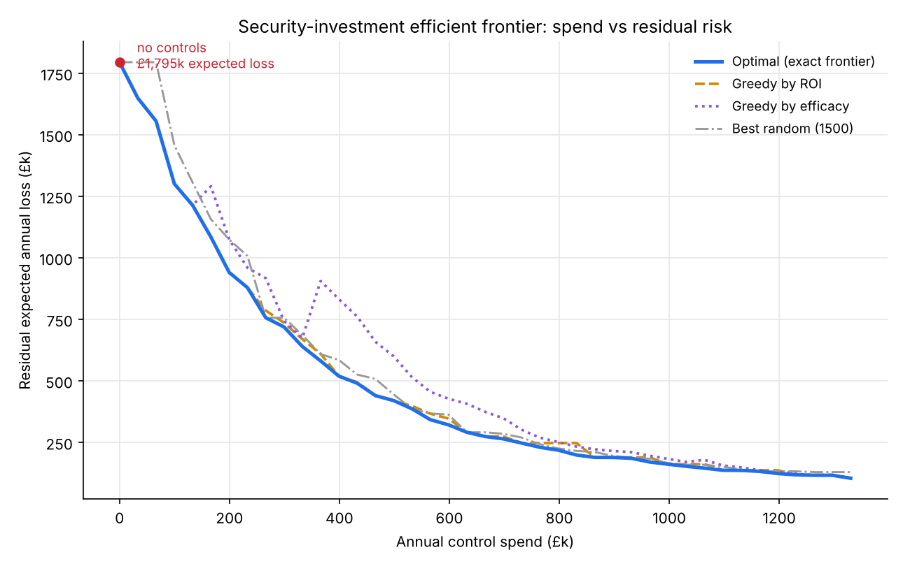

# risk-optimizer — the efficient frontier of security spend

<!-- at-a-glance -->
> **The provably optimal way to spend a security budget — the efficient frontier of spend vs residual risk.**  
> **Result:** 8 tests; the exact optimum dominates every baseline (worked example: 71% loss cut at £400k, greedy £313k/yr worse).  
> **Reproduce:** `pip install -e .[test] && pytest -q   # python examples/run.py`  
> 
>
> **What this is worth:** Answers the CFO question — are we spending the right amount, on the right things — with an optimum, not a heat-map.


**Claim.** Given a set of loss scenarios and a catalog of controls with costs and
efficacies, there is a *provably optimal* way to spend each marginal pound — and the
"obvious" ways practitioners pick controls leave money on the table. This tool computes
the exact frontier and shows the gap.

It extends [RiskBoard](../RiskBoard)'s FAIR Monte-Carlo risk quantification from
*measuring* risk to *allocating capital against it* — the conversation a CISO has with a
CFO.

## The model (and why it's honest)

Each scenario is a FAIR compound-Poisson loss process: loss events arrive at rate `lef`
per year, each costing a lognormal amount with mean `lm_mean` and coefficient of
variation `lm_cv`. Two facts are used exactly, not approximated:

- **Mean annual loss** `E[S] = lef · lm_mean` (Wald's identity) — so the optimisation
  objective is closed-form and exact; no Monte-Carlo noise enters the selection.
- **Tail** (95% VaR and CVaR) comes from simulation with *common random numbers*, so two
  portfolios are compared on the same sampled world.

A control reduces a scenario's frequency and/or magnitude **multiplicatively**; two
controls on the same scenario compose as the product of residual factors. That makes the
benefit of a control-set **submodular** (diminishing returns) — which is exactly why
greedy selection is only a `1 − 1/e` approximation and can be beaten.

## What it computes

- **`pareto_frontier`** — the exact lower envelope of (spend, residual expected loss) by
  enumerating all control subsets (small catalog by design, so the optimum is *exact*,
  not heuristic). `bnb_min_loss` is a pruning branch-and-bound for larger catalogs, and a
  test asserts it equals brute force.
- **Baselines** — greedy-by-ROI, greedy-by-efficacy, best-of-random — to quantify how far
  real-world heuristics fall short of the optimum *at the same budget*.

## Worked example result



On the illustrative mid-market catalog (`examples/catalog.py`):

- Baseline expected annual loss **£1.80M**; 95% tail (CVaR) **£10.5M**.
- At a **£400k** budget the optimum cuts expected loss **71%** to **£520k** (MFA+SSO,
  email filtering, immutable backups, WAF, cloud posture management).
- **Greedy-by-efficacy** — "buy the biggest risk-reducer first" — lands **£313k/year
  worse** than optimal *at the same spend*. That gap is the point.

## Run it

```bash
pip install -e .[test]
pytest -q                 # 8 tests: Wald vs MC, submodular composition, exact knapsack,
                          # B&B == brute force, frontier monotone, optimum dominates baselines
python examples/run.py    # writes examples/out/{frontier.csv,frontier.png,summary.md}
```

## Honest limitations

- The example frequencies, magnitudes and efficacies are **illustrative defaults**, not
  benchmarks — they are the inputs a CISO calibrates to their own loss data, threat intel
  and control assessments. The method is the asset.
- Controls are modelled as independent multiplicative reducers. Real controls can
  interact (a SIEM makes an IR retainer more effective); the model supports per-scenario
  effects but not cross-control synergies — a documented, deliberate simplification.
- Exhaustive enumeration is exponential; it's exact for a reviewable catalog (≤ ~20
  controls). Beyond that, use the branch-and-bound, or an ILP formulation.

## Why this is a leadership proof

It answers the board question — *"are we spending the right amount, on the right things?"*
— with a defensible model and an optimum, not a heat-map. It shows the author can reason
about capital allocation under uncertainty, name the model's limits, and turn a security
posture into an economic argument.
